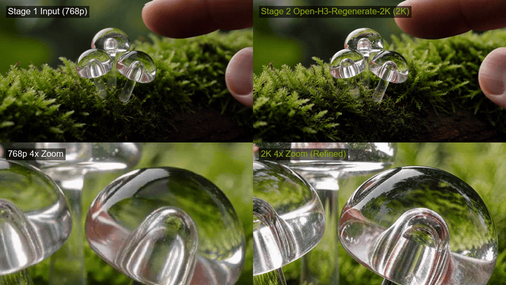
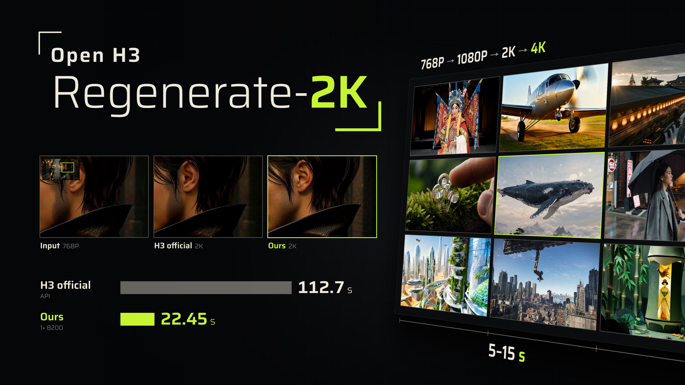

# ComfyUI-Open-H3-Regenerate-2K (Upgraded In-Context `2K-IC` Edition)

Native ComfyUI implementation of the upgraded **In-Context (`Open-H3-Regenerate-2K-IC`)** video refinement pipeline for MiniMax-H3 ([NVlabs Sana Open-H3-Regenerate-2K](https://nvlabs.github.io/Sana/Open-H3-Regenerate-2K/) + [`slmonker/ComfyUI-OpenH3Regenerate2KIC`](https://github.com/slmonker/ComfyUI-OpenH3Regenerate2KIC)), featuring an **Interactive Stage 1 → Stage 2 Approval Gate (Zero Timer, No `Ctrl+M` Needed)**.

---

## Visual Comparison

<p align="center">
  
  <br>
  <em>Top: Full-frame side-by-side (768p draft vs 2K Open-H3-Regenerate-2K-IC). Bottom: 4x center crop comparison showing micro-detail recovery.</em>
</p>

### Interactive Magnifier Tool
Open `interactive_comparison.html` in any browser to hover over the video with a real-time 8x magnifier lens comparing the 768p draft against the 2K refined output.

<p align="center">
  
</p>

---

## Workflows (With Zero-Timer Interactive Approval Gate)

The [`workflows/`](workflows/) directory contains ready-to-run two-stage ComfyUI graphs:

| Workflow | Modality | Stage 1 Output | Stage 2 IC Output |
| :--- | :--- | :--- | :--- |
| [`H3_R2V_2K_Open_Regenerate.json`](workflows/H3_R2V_2K_Open_Regenerate.json) | Reference-to-Video (Ref2VA) | Playable 768p Draft (`SaveVideo`) | $2560 \times 1440$ (2K) or 4K @ 24fps with audio |
| [`H3_I2V_2K_Open_Regenerate.json`](workflows/H3_I2V_2K_Open_Regenerate.json) | Image-to-Video (I2V) | Playable 768p Draft (`SaveVideo`) | $2560 \times 1440$ (2K) or 4K @ 24fps with audio |
| [`H3_T2V_2K_Open_Regenerate.json`](workflows/H3_T2V_2K_Open_Regenerate.json) | Text-to-Video (T2V) | Playable 768p Draft (`SaveVideo`) | $2560 \times 1440$ (2K) or 4K @ 24fps with audio |

---

## How the Upgraded `Open-H3-Regenerate-2K-IC` + Approval Gate Works

1. **Stage 1 (768p Draft Generation & Preview)**:
   - Generates and saves the playable 768p draft video in **Save Video (Stage 1)** first.
2. **Interactive Approval Gate (`H3UpscaleApprovalGate` — Zero Timer, No Manual `Ctrl+M`)**:
   - Because `H3UpscaleApprovalGate` connects directly after Stage 1's `SaveVideo`, Stage 1's playable 768p video is **guaranteed** to appear on screen before Stage 2 begins.
   - Execution pauses **indefinitely (with no countdown timer)** and displays interactive buttons both on a floating top banner and on Node #169:
     - **✅ Approve & Upscale (2x / 2K)**: Proceeds to Stage 2 (`2560×1440` In-Context refinement).
     - **🚀 Approve & Upscale (4x / 4K)**: Proceeds with 4x target scaling.
     - **🛑 Stop Here (Keep 768p Only)**: Cleanly stops right there and keeps your 768p draft!
   - You can also switch `approval_mode` on Node #169 between `"Ask Approval in UI (Wait Indefinitely - No Timer)"`, `"Auto-Upscale Immediately (No Pause)"`, and `"Stop After 768p Draft Only (Do Not Upscale)"`.
3. **Stage 2 (`Open-H3-Regenerate-2K-IC` In-Context 3-Step Refine)**:
   - **`OpenH3ICDraft` (`<Video 1>`)**: Passes the Stage 1 768p draft frames as `ref_videos.ref_video_0` (`<Video 1>`) into Stage 2's `MiniMaxH3ReferenceToVideo`, giving the 2K refiner full in-context visual grounding of every frame.
   - **Official 3D-Conv Latent Upscaler**: `MiniMaxH3LatentUpscaleWithModel` (`minimax_h3_latent_upscaler_3d_conv_v1_bf16.safetensors`) upscales the Stage 1 clean latent to `2560×1440`.
   - **3-LoRA IC Stack**: Applies `minimax_h3_hyperflow_8step_v1.0_comfyui_bf16.safetensors` + `minimax_h3_lms_v1.0_r64.safetensors` + `minimax_h3_open_regenerate_2k_ic_comfy_bf16.safetensors`.
   - **`OpenH3ICSigmas` (`up3`)**: Refines in 3 Euler steps using the official IC sigma grid `[0.834942, 0.696852, 0.468753, 0.0]` with `OpenH3ICComposeLatent` pinning the audio stream during visual refinement.

---

## Installation & Model Download

Clone this repository into `ComfyUI/custom_nodes/`:
```bash
cd ComfyUI/custom_nodes
git clone https://github.com/revolverocelot1/ComfyUI-Open-H3-Regenerate-2K.git
```

Download all required models automatically:
```bash
python ComfyUI-Open-H3-Regenerate-2K/scripts/download_models.py --models-dir /path/to/ComfyUI/models
```
