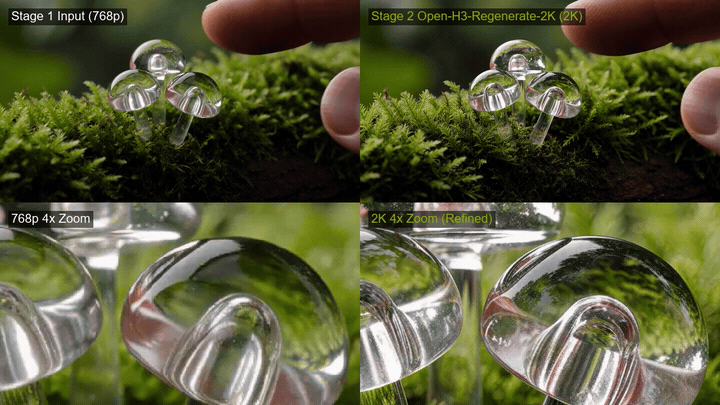
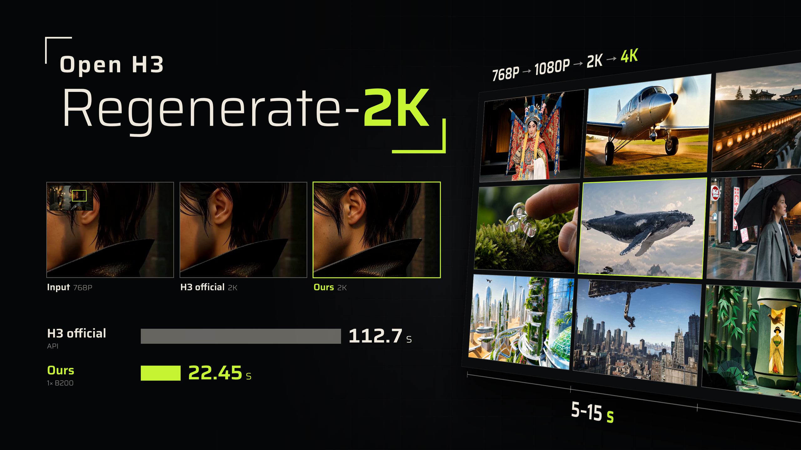

# ComfyUI-Open-H3-Regenerate-2K

Native ComfyUI implementation of the NVLabs [Open-H3-Regenerate-2K](https://nvlabs.github.io/Sana/Open-H3-Regenerate-2K/) video refinement pipeline for MiniMax-H3. 

Provides clean, vanilla ComfyUI workflows for Reference-to-Video (R2V), Image-to-Video (I2V), and Text-to-Video (T2V) without custom engine patches, `FirstBlockCache`, or `Semantic Bridge` modifications.

---

## Visual Comparison

<p align="center">
  
  <br>
  <em>Top: Full-frame side-by-side (768p draft vs 2K Open-H3-Regenerate). Bottom: 4x center crop comparison showing micro-detail recovery.</em>
</p>

### Interactive Magnifier Tool
This repo includes an interactive HTML viewer (`interactive_comparison.html`) based on the NVLabs project page. It lets you hover over the video with a real-time magnifier lens to inspect synchronized 8x crops of the input vs refined output as the clip plays.

To use it, clone the repo and open `interactive_comparison.html` directly in any web browser.

<p align="center">
  
</p>

---

## Workflows

The [`workflows/`](workflows/) directory contains ready-to-run ComfyUI graphs:

| Workflow | Modality | Input | Output |
| :--- | :--- | :--- | :--- |
| [`H3_R2V_2K_Open_Regenerate.json`](workflows/H3_R2V_2K_Open_Regenerate.json) | Reference-to-Video | Face / Body / Pose images + Prompt | $2048 \times 1152$ @ 24fps with audio |
| [`H3_I2V_2K_Open_Regenerate.json`](workflows/H3_I2V_2K_Open_Regenerate.json) | Image-to-Video | Start frame image + Prompt | $2048 \times 1152$ @ 24fps with audio |
| [`H3_T2V_2K_Open_Regenerate.json`](workflows/H3_T2V_2K_Open_Regenerate.json) | Text-to-Video | Text Prompt only | $2048 \times 1152$ @ 24fps with audio |

---

## How it Works

```
Stage 1 (1024x576)                    Latent Upscale (2K)               Stage 2 Refinement (2K)
[Base DiT INT8]                       [FiLM Upscaler e200]             [Open-H3 Refiner LoRA]
  21 steps, Euler linear flow           2x spatial upscale               3 steps continuous flow
  ~67,000 visual tokens                 x0 clean latents -> re-noise     ~268,000 visual tokens
  ~3-5 minutes                          ~2 seconds                       ~15-16 minutes (H100)
        │                                      │                                  │
        └─────────> denoised_output ───────────┴─────────> DisableNoise ──────────┘
```

1. **Stage 1 (Base Draft)**: Generates a standard $1024 \times 576$ (or $1280 \times 720$) video using the quantized base MiniMax-H3 model in 21 steps. Pristine $x_0$ frames are pulled from `denoised_output`.
2. **Latent 2X Upscale**: `MiniMaxH3LatentUpscaleCombined` scales the latent representation using the trained FiLM neural checkpoint (`h3_clean_latent_upscaler_film_epoch200.safetensors`) and injects continuous flow noise up to $\sigma_0 = 0.909375$.
3. **Stage 2 (Refinement)**: The Open-H3-Regenerate-2K LoRA (rank 384) refines high-frequency textures using NVLabs continuous flow schedule:
   $$\sigma = [0.909375, 0.857143, 0.666667, 0.0]$$
4. **Noise Shield**: Stage 2 uses `DisableNoise`. Because the latent upscaler already re-noises to $\sigma_0$, injecting additional noise into the sampler will corrupt the latent space into 200MB of white static noise.
5. **Unified VAE**: Stage 1 and Stage 2 share the same VAE loader nodes, eliminating 6.5 GB of redundant VRAM allocation.

---

## Why Stage 2 Takes 16 Minutes

Generating at 2K ($2048 \times 1152$) is not 2x more compute than 768p—it is over $4\times$ the visual sequence length:

- **Stage 1 (1024×576)**: $107 \text{ latent frames} \times \frac{72 \times 128}{4} \approx 67,000 \text{ tokens}$.
- **Stage 2 (2048×1152)**: $107 \text{ latent frames} \times \frac{144 \times 256}{4} \approx 268,000 \text{ tokens}$.

At 268k tokens, each forward pass through the 14B parameter transformer operates on massive attention tensors. One step at 2K takes roughly as long as 15–18 steps at 768p (~5 minutes per step on an H100).

### Fast 30-Second 2K Bypass
If you are iterating on motion or compositions and don't want to wait 16 minutes:
- Click **Node 207** (`SamplerCustomAdvanced - Stage 2`) and press **`Ctrl + M`** to mute it.
- The upscaled latents will bypass the refiner and decode straight to 2K via the VAE.
- Total generation time drops from 20 minutes to ~4 minutes.

---

## Installation

### 1. Required Custom Nodes
Clone these into your `ComfyUI/custom_nodes/` folder:

```bash
cd ComfyUI/custom_nodes

# Neural latent upscaler node
git clone https://github.com/kijai/ComfyUI-MiniMaxH3_LatentUpscaler.git

# Noise scheduling and routing nodes
git clone https://github.com/kijai/ComfyUI-KJNodes.git

# Video export and audio multiplexing
git clone https://github.com/Kosinkadink/ComfyUI-VideoHelperSuite.git
```

### 2. Download Models
Run the automated download script:
```bash
python scripts/download_models.py --models-dir /path/to/ComfyUI/models
```

Or manually download and place weights into `ComfyUI/models/`:

| Target Path | File | Repo Link |
| :--- | :--- | :--- |
| `models/vae/` | `minimax_h3_video_vae_fp16.safetensors` (4.9 GB) | [Comfy-Org/MiniMax-H3](https://huggingface.co/Comfy-Org/MiniMax-H3/blob/main/split_files/vae/minimax_h3_video_vae_fp16.safetensors) |
| `models/vae/` | `minimax_h3_audio_vae_fp32.safetensors` (580 MB) | [Comfy-Org/MiniMax-H3](https://huggingface.co/Comfy-Org/MiniMax-H3/blob/main/split_files/vae/minimax_h3_audio_vae_fp32.safetensors) |
| `models/text_encoders/` | `qwen3vl_32b_heretic_minimax_h3_nvfp4.safetensors` (15 GB) | [speach1sdef178/MiniMax-H3-Clean-Text-Encoder](https://huggingface.co/speach1sdef178/MiniMax-H3-Clean-Text-Encoder) |
| `models/diffusion_models/` | `Minimax-h3_Singularity_ref2va_Pruned_v1.3_int8.safetensors` (20 GB) | [WarmBloodAban/Minimax-h3_Singularity_ref2va_Pruned_v1.3_int8](https://huggingface.co/WarmBloodAban/Minimax-h3_Singularity_ref2va_Pruned_v1.3_int8) |
| `models/loras/` | `minimax_h3_open_regenerate_2k_refiner_rank_384_bf16.safetensors` (1.8 GB) | [Kijai/MiniMax-H3-experimental](https://huggingface.co/Kijai/MiniMax-H3-experimental/blob/main/loras/minimax_h3_open_regenerate_2k_refiner_rank_384_bf16.safetensors) |
| `models/latent_upscaler/` | `h3_clean_latent_upscaler_film_epoch200.safetensors` (54 MB) | [Kijai/MiniMax-H3-experimental](https://huggingface.co/Kijai/MiniMax-H3-experimental/blob/main/latent_upscalers/h3_clean_latent_upscaler_film_epoch200.safetensors) |

---

## Recommended Launch Flags

To avoid CUDA memory fragmentation during Stage 2:

```bash
# Linux / Cloud (RunPod, Modal, Vast)
export PYTORCH_CUDA_ALLOC_CONF=expandable_segments:True
python main.py --listen --port 8188 --reserve-vram 16.0

# Windows PowerShell
$env:PYTORCH_CUDA_ALLOC_CONF="expandable_segments:True"
python main.py --reserve-vram 16.0
```

> **Note on `--highvram`**: Do not use `--highvram`. It locks the 15 GB Qwen3-VL text encoder into VRAM, causing an out-of-memory crash when the 268k token Stage 2 attention pass begins. Use `--reserve-vram 16.0` instead so ComfyUI offloads the text encoder to system RAM once conditioning is finished.

---

## Troubleshooting

- **Video is pure static or rainbow noise**:
  Check Node 207 (`SamplerCustomAdvanced`). Its `noise` slot must be connected to Node 206 (`DisableNoise`). If connected to `RandomNoise`, noise is applied twice.
- **CUDA OOM on 24GB / 48GB GPUs**:
  Set `PYTORCH_CUDA_ALLOC_CONF=expandable_segments:True` and use `--reserve-vram 12.0`. If 3-step refinement still exceeds memory, bypass Stage 2 (`Ctrl+M` on Node 207) or switch to a 1-step schedule (`[0.909375, 0.0]`).
- **Red missing nodes**:
  Verify all 3 repositories in [Installation](#1-required-custom-nodes) are cloned inside `ComfyUI/custom_nodes/`.
